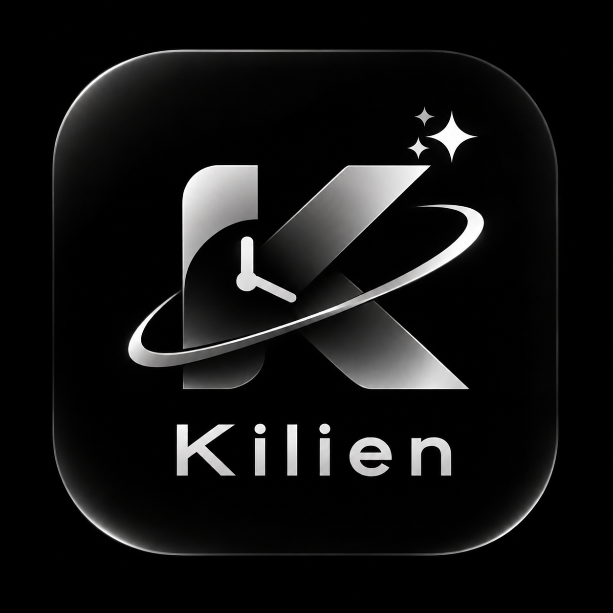

# Kilien

  

<strong>A calm, offline-first space for planning your day and keeping track of what matters.</strong>

Kilien is a personal productivity prototype for organizing tasks, planned events, focus time, and notes. Your information stays in local storage on your device. JSON backups let you manually transfer and merge data between devices; cloud sync is not available.

## Features in the prototype

- Today dashboard for tasks, schedule, completions, and focus time.
- Create, edit, schedule, complete, and delete tasks.
- Browse a monthly calendar and review tasks and events for a selected day.
- Focus countdown and stopwatch, optionally linked to a task.
- Create, edit, delete, and search notes.
- Export, validate, import, and merge JSON backups, with duplicate and conflict handling.
- Offline local SQLite storage.

Habits and routines, AI planning, cloud synchronization, and advanced analytics are not implemented.

## Platform availability

| Platform | Status | Download |
| --- | --- | --- |
| Windows PC | Installer available; prototype | [Kilien 0.1.0 setup](https://github.com/GlennRhey/Kilien-Releases/releases/latest) |
| Android | Not available yet. Expo configuration exists, but no standalone APK has been built and device tested. | None |
| iOS | Not available. Requires macOS/Xcode and Apple signing and distribution setup; no signed build is available. | None |
| Web | Development/export build only; not an official release download. | None |

## Windows installation

1. Open the [latest release](https://github.com/GlennRhey/Kilien-Releases/releases/latest).
2. Download `Kilien_0.1.0_x64-setup.exe` under **Assets** and run it.
3. Follow the Windows installer prompts, then open Kilien from the Start menu.

The prototype installer is not digitally signed, so Windows may show a publisher or reputation warning. Only download it from this official Releases page.

## Android installation

There is currently no Android APK to install. Android is under development and is not yet verified as a standalone release. The repository's Expo Android configuration alone does not constitute a downloadable app.

## iOS installation

There is no iOS download or TestFlight/App Store listing yet. An Apple build environment and Apple Developer signing/distribution setup are required before publishing.

## Data and limitations

Each device stores its data independently in a local SQLite database. Kilien does not currently sync data through a server or cloud account. Use the in-app JSON backup flow to transfer and merge data manually. This is an early prototype; platform coverage and reliability have not received full production validation.

## Latest version and release history

The latest version is **v0.1.0**, an initial pre-release prototype. See the [v0.1.0 release notes](release-notes/v0.1.0.md) and [all releases](https://github.com/GlennRhey/Kilien-Releases/releases).

## Screenshots

Screenshots are not included in this release.
